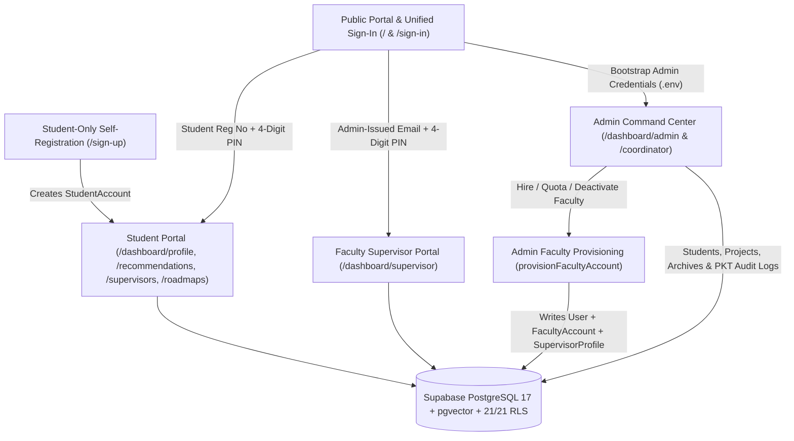

# ProjectCompass

[](https://github.com/AbdullahJan-007/projectcompass/actions/workflows/ci.yml)


**Decoupled 3-Portal FYP Idea, Feasibility, Supervisor Matching & Execution Platform** for the **Department of Information Technology & Computing** (`BSIT` · `BSCS` · `BSSE` · `BSAI` · `BSCY` · `BSDS`) across all Fall & Spring academic batches, calibrated to **Pakistan Standard Time (Islamabad · `Asia/Karachi` · PKT)**.

---

## Key Capabilities & Recent Highlights (v2.1)

- **Decoupled 3-Portal Architecture:** Strictly isolated **Student Portal**, **Faculty Supervisor Portal**, and **Admin Command Center** backed by server-side route guards, HMAC-SHA256 sessions, and deactivated-account login blocking.
- **Admin-Only Faculty Provisioning & Governance:** Students self-register at `/sign-up` (with **FYP Group Partner Linking** for 2–3 student teams via Reg No), while Faculty Supervisors are **login-only** and hired exclusively via the Admin Command Center — alongside **Admin PIN Reset**, **Direct Project Supervisor Assignment**, and **Allocation Matrix / Student Roster CSV Exports**.
- **Academic Navy Design System & Custom SVG Identity:** Built with the official ProjectCompass Astrolabe SVG mark ([projectcompass-logo.svg](public/projectcompass-logo.svg) & [icon.svg](src/app/icon.svg)), clean `Plus Jakarta Sans` + `Inter` (`tabular-nums`) typography, zero-network `lucide-react` inline SVG icons (`<AppIcon />`), single collapsible `PanelLeft` sidebar (`Ctrl+B`), **Live Notification Bell**, and **Self-Service Change PIN**.
- **Live Islamabad (`Asia/Karachi`, PKT) Time & Calendar Engine:** Live ticking PKT clock in headers, dynamic PKT academic cycle & archive years, PKT-formatted audit trail timestamps, live Islamabad calendar date ranges on every 24-week roadmap milestone, and one-click **Formal FYP Proposal PDF Dossier** printing.
- **3-Stage Hybrid Recommendation Engine & Bulk Archive Import:** Deterministic SQL filtering + `pgvector` HNSW cosine similarity (42 archetypes & historical archives with **Bulk CSV Archive Importer** up to 100 rows/batch) + explainable 100-point Feasibility Math + guardrailed Google Gemini / OpenAI synthesis with `COMPLETED_FALLBACK` resilience.
- **Production-Hardened Supabase PostgreSQL 17:** 21 normalized models, `21/21` Row Level Security (RLS) lockdown, `0` unindexed foreign keys, `pgvector` HNSW indexes, and strict local-only `SEED_DEMO_DATA` separation.

---

## 3-Portal Architecture & Strict Access Boundaries



| Portal | Provisioning & Auth | Isolated Capabilities |
| :--- | :--- | :--- |
| **Student Portal** | **Public Self-Registration** at `/sign-up` (Reg No `B[YY][F/S][4-Digits][DEPT][3-Digits]` + 4-digit PIN) | Skill & Time Profile, 3-Track FYP Recommendations (`CORE_SAFE`, `CAREER_STRETCH`, `RESEARCH_NICHE`), Supervisor Matching (`70/20/10`), PostgreSQL-persisted 24-Week Execution Roadmaps & Markdown Export |
| **Faculty Supervisor Portal** | **Login-Only** at `/sign-in`. **Zero public faculty signup.** Provisioned exclusively via Admin Panel into Supabase DB. | Manage research domains, preferred stacks & slot quotas; accept/decline incoming student pitches with atomic slot locking (`activeSlots < maxSlots`) |
| **Admin Command Center** | **Bootstrap Admin via `.env`** (`BOOTSTRAP_ADMIN_EMAIL`, `BOOTSTRAP_ADMIN_PIN`, `BOOTSTRAP_ADMIN_NAME`) with Last-Admin protection | Hire & manage Faculty Supervisors, inspect all Student profiles and projects, ingest/index past FYP archives (`pgvector`), override quotas, deactivate accounts, and review immutable PKT Audit Logs |

---

## Tech Stack

| Layer | Technology |
| :--- | :--- |
| **Framework & UI** | Next.js 15.5 (App Router + Turbopack), React 19, TypeScript 5.9 (Strict), Tailwind CSS v4, Radix UI, Lucide Inline SVGs (`<AppIcon />`), `Plus Jakarta Sans` + `Inter` |
| **Database & Vectors** | Supabase PostgreSQL 17, Prisma ORM 6.19, `pgvector` (`vector(1536)` + HNSW cosine indexes), `21/21` tables RLS enabled, `0` unindexed FKs |
| **AI & Embeddings** | Vercel AI SDK (`generateObject`, `embed`), Google Gemini (`gemini-3.8-flash` / `gemini-embedding-001`) or OpenAI-compatible providers, Zod |
| **Auth & Security** | HMAC-SHA256 expiring `HttpOnly` sessions (fail-closed `AUTH_SECRET` in production), salted SHA-256 4-digit PIN, pre-DB rate limiting, strict server-side layout guards |
| **Time & Localization** | Live Pakistan Standard Time (`Asia/Karachi`, Islamabad · PKT / UTC+5) via `src/lib/time/pakistan-time.ts` |
| **Testing & CI/CD** | Vitest 3.2 (31 unit/integration/security tests), Playwright 1.65 (3 E2E specs), GitHub Actions (`pgvector` container), Vercel, Docker |

---

## Quick Local Setup & Production Deployment (Supabase + Vercel)

1. **Install Dependencies:**
   ```bash
   pnpm install
   ```
2. **Configure `.env` (Never Commit):**
   Copy [`.env.example`](.env.example) to `.env` and set `DATABASE_URL` (Supabase Transaction Pooler `:6543`), `DIRECT_URL` (Session Pooler `:5432`), `AUTH_SECRET` (64-char random hex), `BOOTSTRAP_ADMIN_EMAIL`, `BOOTSTRAP_ADMIN_PIN`, `BOOTSTRAP_ADMIN_NAME`, and optional `AI_API_KEY`.
3. **Sync Schema & Seed Clean Reference Catalog:**
   ```bash
   pnpm prisma generate
   pnpm exec tsx prisma/ensure-vector.ts
   pnpm prisma db push
   pnpm db:seed
   ```
   > By default (`SEED_DEMO_DATA` unset or `"false"`), `pnpm db:seed` seeds **only** the reference catalog (6 IT departments, 62 skills, 42 `pgvector` archetypes, 12 market benchmarks) plus your **1 Bootstrap Admin** from `.env` — zero dummy students, supervisors, or archives.
4. **Run Locally (Fast Turbopack Dev Server):**
   ```bash
   pnpm exec next dev --turbopack
   ```
5. **Deploy on Vercel:**
   - Import the repo in Vercel and add `DATABASE_URL`, `DIRECT_URL`, `AUTH_SECRET`, `BOOTSTRAP_ADMIN_NAME`, `BOOTSTRAP_ADMIN_EMAIL`, `BOOTSTRAP_ADMIN_PIN`, `NEXT_PUBLIC_APP_URL`, and optional `AI_API_KEY`.
   - Set **Vercel Function Region** near your Supabase region (e.g., `hnd1` Tokyo for `ap-northeast-1`).
   - Verify `GET /api/health` returns `{"status":"ok","db":"connected"}`.

---

## Documentation Index

| Document | Scope |
| :--- | :--- |
| [`ANTIGRAVITY_RULES.md`](ANTIGRAVITY_RULES.md) | Non-negotiable 3-portal isolation, UI/icon/font, PKT timezone & fail-closed DB rules |
| [`CHANGELOG.md`](CHANGELOG.md) | Complete release history and engineering updates |
| [`docs/specs/01-product-brief.md`](docs/specs/01-product-brief.md) | Product vision, scope, RBAC matrix, user stories, functional & NFRs |
| [`docs/specs/02-workflows.md`](docs/specs/02-workflows.md) | State machines, transitions, failure paths, idempotency rules |
| [`docs/specs/03-architecture.md`](docs/specs/03-architecture.md) | System architecture, 3-stage hybrid engine formulas, repository structure |
| [`docs/specs/04-database-schema.md`](docs/specs/04-database-schema.md) | Prisma schema, `pgvector` HNSW indexes, 21/21 RLS, reference catalog |
| [`docs/specs/05-api-design.md`](docs/specs/05-api-design.md) | Server Actions vs. Route Handlers, Zod contracts, error taxonomy |
| [`docs/specs/06-ai-policy.md`](docs/specs/06-ai-policy.md) | Embeddings, anti-duplicate thresholds, prompt-injection guardrails, fallback policy |
| [`docs/specs/07-design-system.md`](docs/specs/07-design-system.md) | Academic Navy tokens, `Plus Jakarta Sans` + `Inter`, SVG `<AppIcon />`, collapsible sidebar |
| [`docs/specs/08-security-threat-model.md`](docs/specs/08-security-threat-model.md) | STRIDE threat model, Admin-only faculty provisioning, HTTP security headers |
| [`docs/specs/09-testing-strategy.md`](docs/specs/09-testing-strategy.md) | Unit, integration, concurrency, red-team security & Playwright E2E suites |
| [`docs/specs/10-deployment-and-ops.md`](docs/specs/10-deployment-and-ops.md) | CI/CD pipeline, Supabase + Vercel deployment, observability, cost tiers |
| [`docs/specs/11-roadmap-and-execution-plan.md`](docs/specs/11-roadmap-and-execution-plan.md) | Completed milestones & post-MVP roadmap |
