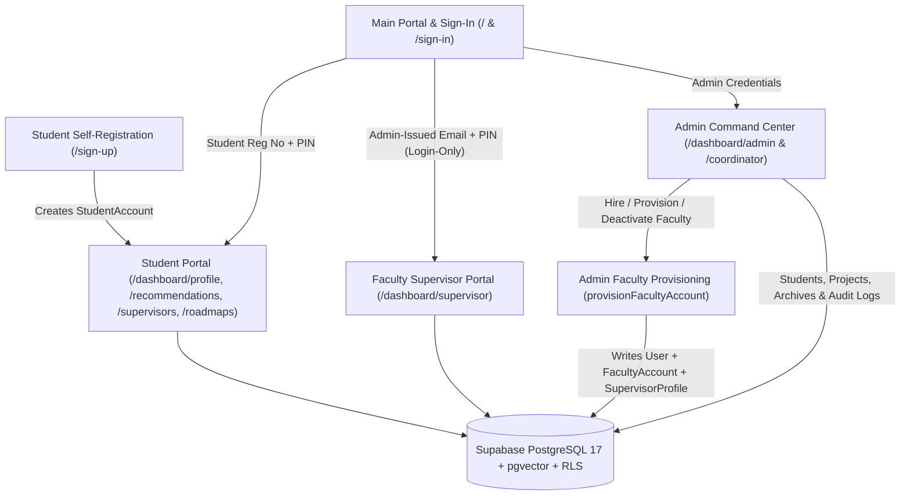

# ProjectCompass

[](https://github.com/AbdullahJan-007/projectcompass/actions/workflows/ci.yml)


**Decoupled Multi-Portal FYP Idea, Feasibility & Supervisor Recommendation Platform** for the **Department of Information Technology & Computing** (`BSIT` · `BSCS` · `BSSE` · `BSAI` · `BSCY` · `BSDS`) across all Fall & Spring academic batches.

**Author:** Abdullah Jan

---

## 3-Portal Architecture & Strict Access Boundaries

ProjectCompass cleanly isolates **Student**, **Faculty Supervisor**, and **Admin Command Center** workflows with strict server-side route guards and Admin-only faculty provisioning:



| Portal | Provisioning & Auth | Isolated Capabilities |
| :--- | :--- | :--- |
| **Student Portal** | **Public Self-Registration** at `/sign-up` (Reg No `B[YY][F/S][4-Digits][DEPT][3-Digits]` + 4-digit PIN) | Skill & Time Profile, 3-Track FYP Recommendations (Hybrid SQL + `pgvector` + Gemini/OpenAI SDK), Supervisor Matching, Execution Roadmaps & Markdown Export |
| **Faculty Supervisor Portal** | **Login-Only** at `/sign-in`. **Zero public faculty signup.** Provisioned exclusively via Admin Panel into Supabase DB so external users cannot register or log in as faculty. | Manage research domains, tech stacks & slot quotas; accept/decline incoming student pitches with atomic PostgreSQL slot locking (`activeSlots < maxSlots`) |
| **Admin Command Center** | **Governance-Controlled** (Last-Admin protection) | Hire & provision Faculty Supervisors, search & inspect all Student profiles and projects, manage past FYP archives (`pgvector`), override supervisor quotas, and review immutable Audit Logs |

---

## 3-Stage Hybrid Recommendation Engine

1. **Stage 1 — Deterministic SQL Filtering & Capacity Guard:** Resolves student batch/program from Reg No, enforces supervisor availability (`activeSlots < maxSlots` and `isAccepting = true`), and filters archetypes by effort budget.
2. **Stage 2 — Semantic Retrieval (`pgvector` HNSW) & Explainable Feasibility Math:** Computes cosine similarity across 42 curated archetypes and historical FYP archives, flags near-duplicates (`>= 0.72` Moderate, `>= 0.82` High), and scores feasibility (`Skill 40 + Time 30 + Resource 20 + Supervisor Fit 10 = 100`).
3. **Stage 3 — MMR Diversity & Guardrailed AI Synthesis:** Selects 3 distinct tracks (`CORE_SAFE`, `CAREER_STRETCH`, `RESEARCH_NICHE`) and synthesizes grounded framing via Vercel AI SDK (Google Gemini `gemini-3.8-flash` / OpenAI-compatible) with strict Zod schemas and `COMPLETED_FALLBACK` resilience.

---

## Tech Stack

| Layer | Technology |
| :--- | :--- |
| **Framework & UI** | Next.js 15.5 (App Router), React 19, TypeScript 5.9 (Strict), Tailwind CSS v4, Radix UI / shadcn/ui, Lucide Icons |
| **Database & Vectors** | Supabase PostgreSQL 17, Prisma ORM 6.19, `pgvector` (`vector(1536)` + HNSW indexes), `21/21` tables RLS enabled |
| **AI & Embeddings** | Vercel AI SDK (`generateObject`, `embed`), Google Gemini (`gemini-3.8-flash` / `gemini-embedding-001`) or OpenAI-compatible providers, Zod |
| **Auth & Security** | HMAC-SHA256 expiring `HttpOnly` sessions (fail-closed `AUTH_SECRET` in production), salted SHA-256 4-digit PIN, pre-DB canonical rate limiting, strict server-side layout guards |
| **Testing & CI/CD** | Vitest 3.2 (31 unit/integration/security tests), Playwright 1.65 (3 E2E specs), GitHub Actions (`pgvector` container), Vercel, Docker |

---

## Quick Local Setup & Production Deployment (Supabase + Vercel)

1. **Install & Configure:**
   ```bash
   pnpm install
   ```
   Copy `.env.example` to `.env` and configure `DATABASE_URL` (Supabase Transaction Pooler `:6543`), `DIRECT_URL` (Session Pooler `:5432`), `AUTH_SECRET` (32+ random chars), and optional `AI_API_KEY` (Google Gemini or OpenAI-compatible).
2. **Sync Schema & Seed Reference Catalog:**
   ```bash
   pnpm prisma generate
   pnpm exec tsx prisma/ensure-vector.ts
   pnpm prisma db push
   pnpm db:seed
   ```
   > `pnpm db:seed` seeds **only** the production reference catalog (6 IT departments, 62 skills, 42 archetypes, 12 market benchmarks). Demo accounts are strictly local/CI-only (`SEED_DEMO_DATA=true` in non-production).
3. **Deploy on Vercel:**
   - Import the repo in Vercel, add `DATABASE_URL`, `DIRECT_URL`, `AUTH_SECRET`, `NEXT_PUBLIC_APP_URL`, and optional `AI_API_KEY`.
   - Set **Vercel Function Region** near your Supabase region (e.g., `hnd1` Tokyo for `ap-northeast-1`) for `< 15ms` DB round-trips.
   - Verify `GET /api/health` returns `{"status":"ok","db":"connected"}`.

---

## Documentation Index

| Document | Scope |
| :--- | :--- |
| [`ANTIGRAVITY_RULES.md`](ANTIGRAVITY_RULES.md) | Mandatory 3-portal isolation boundaries, fail-closed persistence & query optimization rules |
| [`AUDIT_REPORT.md`](AUDIT_REPORT.md) | Full-stack performance, silent-save & faculty-isolation root-cause audit |
| [`CHANGELOG.md`](CHANGELOG.md) | Release history and engineering updates |
| [`docs/specs/01-product-brief.md`](docs/specs/01-product-brief.md) | Product vision, scope, RBAC matrix, user stories, functional & NFRs |
| [`docs/specs/02-workflows.md`](docs/specs/02-workflows.md) | State machines, transitions, failure paths, idempotency rules |
| [`docs/specs/03-architecture.md`](docs/specs/03-architecture.md) | System architecture, 3-stage hybrid engine formulas, repository structure |
| [`docs/specs/04-database-schema.md`](docs/specs/04-database-schema.md) | Prisma schema, `pgvector` HNSW indexes, pooling rules, reference catalog |
| [`docs/specs/05-api-design.md`](docs/specs/05-api-design.md) | Server Actions vs. Route Handlers, Zod contracts, error taxonomy |
| [`docs/specs/06-ai-policy.md`](docs/specs/06-ai-policy.md) | Embeddings, anti-duplicate thresholds, prompt-injection guardrails, fallback policy |
| [`docs/specs/07-design-system.md`](docs/specs/07-design-system.md) | WCAG 2.1 AA light-theme tokens, responsive layout contract |
| [`docs/specs/08-security-threat-model.md`](docs/specs/08-security-threat-model.md) | STRIDE threat model, Admin-only faculty provisioning, HTTP security headers |
| [`docs/specs/09-testing-strategy.md`](docs/specs/09-testing-strategy.md) | Unit, integration, concurrency, red-team security & Playwright E2E suites |
| [`docs/specs/10-deployment-and-ops.md`](docs/specs/10-deployment-and-ops.md) | CI/CD pipeline, Supabase + Vercel deployment, observability, cost tiers |
| [`docs/specs/11-roadmap-and-execution-plan.md`](docs/specs/11-roadmap-and-execution-plan.md) | Completed milestones (Phases 0–5) & post-MVP FYP-MS roadmap |
